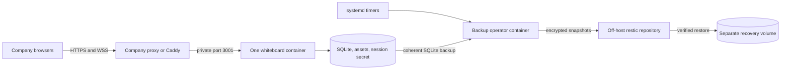

# Company-server deployment

This package runs the authenticated collaborative whiteboard on one Linux server.
It supplies a pinned Node 24 LTS image, optional Caddy HTTPS, durable storage,
restart/drain behavior, encrypted backups, restore drills and operating checks.
The target company host still needs to be identified, provisioned and verified.



## Information for the server administrator

Start with 2 vCPU, 4 GiB RAM and 40 GiB SSD for a small private team, then measure
the actual workload. Provide an SSH account with approved Docker/service access,
a hostname, the certificate/DNS owner, expected concurrent editors and an off-host
backup destination. An SSH key can be used; the application does not need an SSH
password. No server credentials are kept in this repository.

The administrator can run this read-only inventory and share its output:

```sh
sh deploy/preflight.sh
```

Use a maintained Linux distribution with Docker Engine and Compose **2.24.0 or
newer**, and enable Docker at boot. Docker installation is a host administration
step; follow the [official instructions](https://docs.docker.com/engine/install/)
for the host's distribution. The container image supplies Node and dependencies;
Node/pnpm are not required on the host. Do not copy macOS `node_modules` to Linux.

Keep SQLite volumes on local or single-host block storage, not NFS/SMB. Start
with one app replica; this is not a multi-host/high-availability topology.
The server and its reverse proxy must be on the same host or trusted private
container network. The backend is published only on host loopback.

## First installation

Place the approved checkout at `/opt/threejs-whiteboard` (the systemd templates
use this path). From that checkout:

```sh
cp deploy/.env.example deploy/.env
cp deploy/backup.env.example deploy/backup.env
chmod 600 deploy/.env deploy/backup.env
```

Edit `deploy/.env` with the actual hostname, a unique stable backup-host label,
and an image tag identifying the approved Git commit. Use a DNS name without
`https://` or a path. Keep data-volume names stable across redeployments.

Create a random backup encryption password without displaying it. The secret is
read by container UID/GID 1000, not by the app container:

```sh
sudo install -d -m 700 deploy/secrets
sudo sh -c 'umask 077; openssl rand -base64 48 > deploy/secrets/restic-password'
sudo chown 1000:1000 deploy/secrets/restic-password
sudo chmod 600 deploy/secrets/restic-password
```

Do this **once**, before repository initialization. Store a recovery copy of the
password in the company password manager, separately from this server. Replacing
it later does not change the password of an existing restic repository.

Edit `deploy/backup.env` with the off-host restic repository and its scoped
storage credentials. The example uses S3-compatible storage. Choose a dedicated
repository/bucket prefix; backup jobs retain 7 daily, 4 weekly and 6 monthly
snapshots for this deployment. The image contains restic but no credentials.
The backup repository's credentials and encryption password must survive loss
of this host. Google OAuth configuration, if added later, needs separate secure
configuration backup; the application snapshot contains database/assets/session
secret, not host deployment configuration.

Build and start from `deploy/` so Compose resolves the correct `.env`:

```sh
cd /opt/threejs-whiteboard/deploy
docker compose build app
docker compose up -d --wait app
docker compose exec app node --import tsx packages/server/src/provision.ts owner
```

Provisioning prints a generated password once; store it privately. Provision
additional accounts with the same command before sharing boards with them.
The persistent volume contains `/data/live/whiteboard.sqlite`, `assets/` and
`session-secret`. Credentials and data are not baked into the image.

## HTTPS: use one of these paths

**Existing company proxy:** leave the `https` profile off. Proxy the hostname to
`http://127.0.0.1:3001`, preserving Host and forwarding WebSocket upgrades for
`/collaboration`. Set the final `X-Forwarded-For` hop to the real client address,
support 20 MiB uploads, and avoid caching `/api/*`. The configured public origin
is `https://WHITEBOARD_DOMAIN`; cookies are Secure/HttpOnly. For an internal-only
hostname, use a certificate trusted by company browsers and devices.

**Dedicated public hostname with no existing proxy:** point DNS to this host,
allow incoming TCP 80/443, and start Caddy:

```sh
docker compose --profile https up -d --wait app proxy
```

Caddy obtains/renews the certificate, redirects HTTP to HTTPS and forwards WSS.
Its certificate state has separate persistent volumes. Do not start this profile
if ports 80/443 belong to another service. `localhost` uses Caddy's private test CA
in the CI smoke; that does not establish trust for an internal company hostname.
For DNS-only/internal deployment, agree on corporate TLS provisioning with IT.

## Backups and monitoring

After the live database exists and the remote storage configuration is correct:

```sh
docker compose --profile operations run --rm --no-deps backup init
docker compose --profile operations run --rm --no-deps backup backup
docker compose --profile operations run --rm --no-deps backup verify
docker compose --profile operations run --rm --no-deps backup status
```

Run `init` only when creating a new restic repository; use the existing password
when adopting an existing repository. A backup uses SQLite's coherent online
backup API plus referenced immutable assets, verifies a local restore, uploads
an encrypted snapshot, checks repository metadata, then applies scoped retention.
A failed step exits nonzero and does not advance the success timestamp. Kernel
locks prevent overlapping backup/verify/restore jobs. A restore drill downloads
the latest snapshot and verifies all application-file hashes and SQLite integrity.
It does not replace the running application's data.

Install the timers after those manual checks pass:

```sh
sudo cp systemd/threejs-whiteboard-* /etc/systemd/system/
sudo systemctl daemon-reload
sudo systemctl enable --now threejs-whiteboard-backup.timer threejs-whiteboard-verify.timer threejs-whiteboard-check.timer
```

Backups run daily, restore verification weekly, and operating checks hourly.
Checks fail if readiness fails, storage falls below 10% free space/inodes or
1 GiB, a backup is older than 26 hours, or restore verification is older than
8 days. Connect failed units and Docker health status to the company's existing
monitoring/alerting system; these files do not send external notifications.
The app restarts after process failure/reboot, logs rotate at 3 × 10 MiB, and
shutdown allows 30 seconds for its 5-second drain and store cleanup.

```sh
sh check.sh
docker compose ps
docker compose logs --tail 100 app
systemctl list-timers 'threejs-whiteboard-*'
journalctl -u threejs-whiteboard-backup.service -u threejs-whiteboard-check.service
```

Backup staging and downloaded restore checks need space for multiple copies of
the database/assets, in addition to the live volume. Check Docker's storage disk
as well as the application volume. Do not use `docker compose down --volumes`
on a real deployment; named volumes are the persistent state.

## Recovery and upgrades

To recover, set `WHITEBOARD_RESTORE_VOLUME` in `deploy/.env` to a **new** volume
name, then run:

```sh
docker compose --profile operations run --rm --no-deps backup restore
```

An optional snapshot ID may follow `restore`. The command refuses an existing
`/restore/live` directory and verifies the downloaded data before publishing it.
It leaves the running service and original data volume unchanged. After review,
stop the app, change `WHITEBOARD_DATA_VOLUME` to that recovery-volume name, and
start the app again. Both app and future backup jobs must use the recovered
volume. Confirm session login, board permissions, image bytes and collaborative
edits before resuming normal use. Keep the original volume until recovery is
accepted. Do not run two application instances against the same data volume.

Before an upgrade, take a successful backup, fetch the approved commit and set
`WHITEBOARD_IMAGE` to a new commit-specific tag. Build the new image while the
old app remains running, then `docker compose up -d --no-deps --wait app`.
Keep the previous image available. Reverting its tag is an application rollback
only; a database schema rollback may require the verified pre-upgrade backup.
Never clear the data volume as part of an application upgrade.

## Verification and acceptance

The `Deployment infrastructure` workflow checks Linux/Node 24 typechecking and
backend tests, shell/systemd syntax, and a disposable Docker deployment. The
deployment smoke verifies real HTTPS certificate validation, Secure cookies,
unauthorized access/Origin rejection, editor/viewer permissions, WSS edits and
presence, images, restart persistence, encrypted restic backup, isolated restore,
recovered accounts/membership/document/assets and logout. It never targets a
configured company deployment; it creates unique test volumes and removes only
those disposable resources. The test's encrypted repository is local; the
company's real off-host storage transport still needs validation.

Run on a Linux machine with Docker, Node 24 and the workspace dependencies:

```sh
pnpm exec tsx packages/loadtest/src/deployment-smoke.ts --run-isolated-stack
```

Before company launch, also demonstrate two browser sessions through the actual
company proxy, upload/export, reconnect after a restart, a host reboot, off-host
backup/restore, monitoring delivery and representative load. Those are host
acceptance gates, not claims made by a CI pass. Install only after the server
administrator confirms the hostname, storage, access and TLS plan.

Configuration behavior follows the official
[Compose service reference](https://docs.docker.com/reference/compose-file/services/),
[Caddy proxy documentation](https://caddyserver.com/docs/caddyfile/directives/reverse_proxy),
and [restic backup documentation](https://restic.readthedocs.io/en/stable/040_backup.html).
